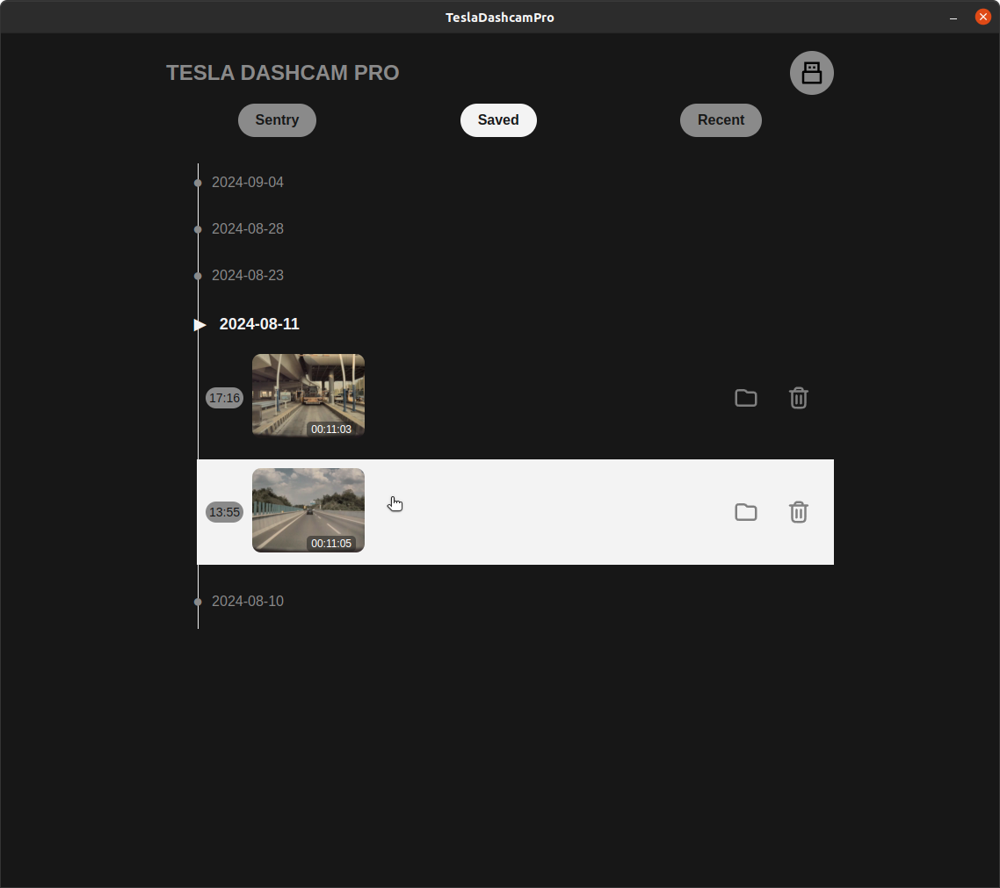
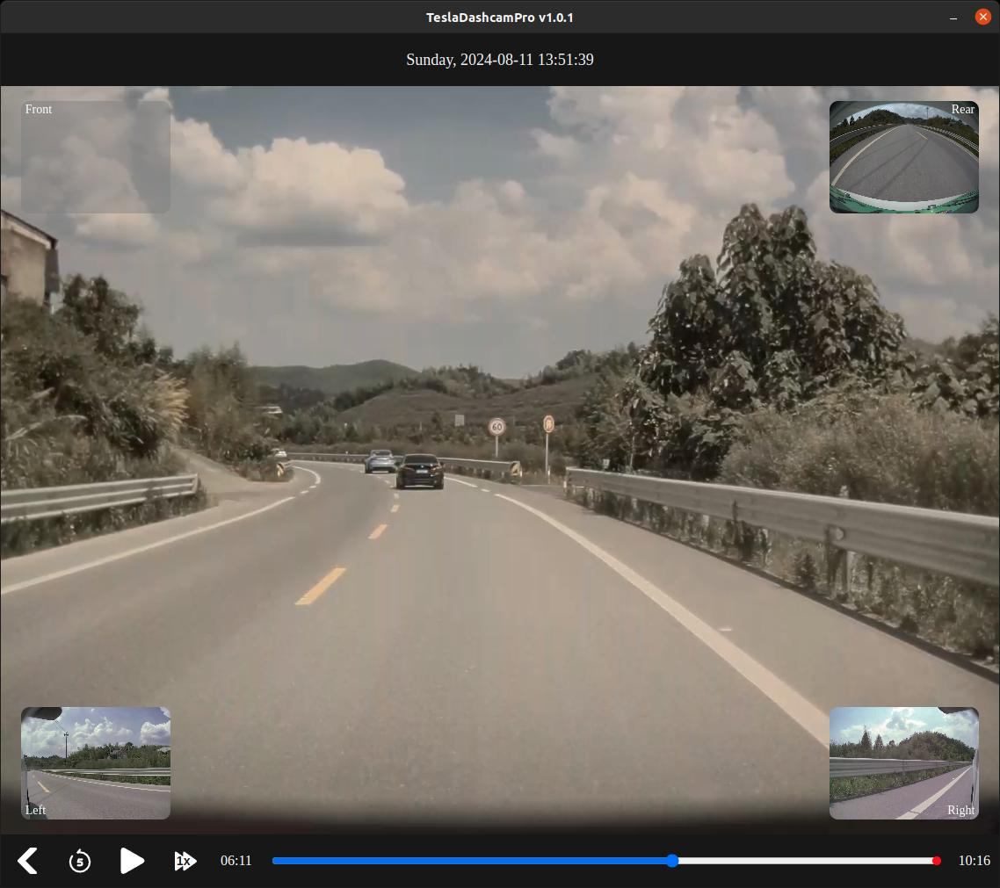

||  &#11015;[软件安装](./install.md)&#11015; ||  [bilibili视频：【开源项目】特斯拉车主来看看，我开发的行车记录仪播放器](https://www.bilibili.com/video/BV1Gdwue5EAz/?share_source=copy_web&vd_source=e201eeec19f502aae9dad5b9e17dba11)

    
    <h1>Tesla 行车记录仪播放器</h1>

## 开发初衷

_整理行车记录仪，想要查看并保存一些有意义的视频片断时，发现U盘里的行车记录仪是1分钟1个视频文件，1个视角1个视频文件，查看起来较为困难。_

_Github上已有的项目，没有现成的可以直接运行的电脑软件。_

**本项目开发的软件可以在电脑上方便的查看行车记录仪内容，支持MacOS，Windows(win10及以上)，Linux系统。**

## 主要特点

播放界面的设计尽量和车机保持了一致，目前支持：

* 读取整个TeslaCam文件夹或者单个文件夹
* 前后左右4路视频同时播放
* 前后左右左前右前6路视频同时播放
* 点击切换多个视角
* 时间戳显示
* 进度条点击跳转
* 回退5s
* 倍速播放（1x，2x，4x，8x）
* 键盘播放控制
    * 空格 播放暂停切换
    * ← 回退5s
    * → 前进5s
    * →长按 3倍速播放
* 显示哨兵和保存的视频片段的触发时间点（进度条上的红点）
* 打开视频所在文件夹位置
* 删除视频
